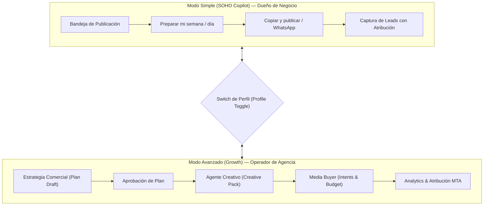
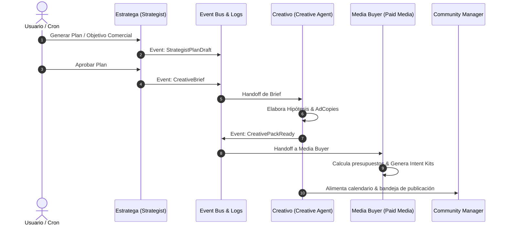

# 🏛️ Auditoría Estratégica Integral: Mkt Agency OS
**Roles de evaluación**: Experto en Arquitectura de IA Agéntica | Diseñador UX/UI Fluid Interface | Director Corporativo de Marca | Estratega Senior de Redes Sociales (10+ años)

---

## Executive Summary & Scorecard

| Pilar de Evaluación | Calificación | Estado Actual | Veredicto Rápido |
| :--- | :---: | :---: | :--- |
| **1. UX/UI: Simplicidad & Modos (SOHO vs Growth)** | **8.8 / 10** | **Excelente** | *Fluid Interface* de nivel Apple con elevación, springs y safe areas. El modo SOHO elimina la parálisis por análisis; el modo Growth da la granularidad requerida para escalar. |
| **2. Calidad Creativa, Virales & Conversión (Prompts & Arte)** | **8.2 / 10** | **Notable** | La combinación de *Media Kit real + Mockup + CM Virtual* resuelve el mayor pecado de la IA: las alucinaciones abstractas. Los copys son sólidos, pero requieren ganchos más disruptivos y marcos de persuasión directa. |
| **3. Harness de IA & Agencia Autónoma Independiente** | **8.9 / 10** | **Sobresaliente** | Arquitectura desacoplada, multi-tenant por diseño, pipelines asíncronos con BullMQ y patrón de eventos estructurados entre agentes (Estratega → Creativo → Media Buyer). |

---

## 1. Análisis UX/UI: Experiencia, Modos SOHO vs. Growth y Percepción de Marca

### 1.1. Principios de Diseño Fluid Interface (Apple Design System)
- **Elevaciones y Profundidad**: La transición de `box-shadow: none !important` hacia el sistema de 4 capas (`--shadow-sm` a `--shadow-xl`) devuelve la tangibilidad a los elementos interactivos. Las tarjetas flotan con propósito visual.
- **Materiales Translúcidos**: El uso de `backdrop-filter: blur(20px) saturate(180%)` en desktop y adaptativo a `blur(12px)` en mobile mantiene tasas de 60fps estables sin degradación de GPU.
- **Microinteracciones y Feedback Háptico**: El `pointer-down` (`scale(0.97)` en <80ms) transforma la sensación de "página web estática" en la de una "aplicación nativa de macOS/iOS".
- **Comportamiento Mobile / iPad**:
  - `h-[100dvh]` y soporte estricto de `env(safe-area-inset-*)` resuelve el salto del viewport móvil en Safari.
  - En pantallas `< 640px`, la transformación de modales en *bottom sheets* con *swipe-to-dismiss* (> 80px) es un acierto ergonómico de estándar de la industria.

### 1.2. Modo Simple (SOHO Copilot) vs. Modo Avanzado (Growth Agency)



#### Fortalezas
- **SOHO (Cognitive Load Reduction)**: Un solo punto focal en el día a día. El usuario no tiene que inventar qué publicar: da clic en *«Preparar mi semana»*, revisa la pieza pre-compuesta con capturas de su producto, y presiona *«Copiar y publicar»*.
- **Growth (Granularidad de Agencia)**: Expone las palancas que un account manager o estratega necesita: hipótesis creativas, ángulos de dolor, asignación de presupuesto por plataforma y monitoreo de eventos entre agentes.

### 1.3. La Paradoja de Inteligencia SOHO: Democratizando las Palancas de Growth sin Complejidad Cognitiva

Actualmente existe una brecha de percepción en el modo SOHO:
- **El backend YA investiga y razona**: El pipeline `prepare-week` (`copilot-orchestration.service.ts`) descubre automáticamente competidores locales con Tavily, ejecuta `CompetitorIntelService`, detecta *market gaps* (vacíos de mercado) y calcula ángulos de contra-posicionamiento.
- **El frontend de SOHO oculta el valor**: Al presentar únicamente el texto y la imagen con el botón *«Copiar y publicar»*, el usuario no percibe el cerebro estratégico detrás del post y corre el riesgo de interpretarlo como "texto genérico de IA".

```
┌────────────────────────────────────────────────────────────────────────┐
│  1. RADAR DE OPORTUNIDAD SEMANAL (Header de Bandeja)                   │
│  "Esta semana atacamos la falta de soporte de tus competidores directos"│
├────────────────────────────────────────────────────────────────────────┤
│  2. CÁPSULA ESTRATÉGICA EN CADA CARD ("Por qué vende este post")       │
│  [🎯 Dolor: Tiempos de espera]  [⚔️ Ángulo vs: Rival A]  [💡 PAS]      │
├────────────────────────────────────────────────────────────────────────┤
│  3. REGENERACIÓN CONTEXTUAL POR ÁNGULO (1-Click Pivot)                 │
│  "Cambiar ángulo: Probar Prueba Social | Probar Miedo a Perder (FOMO)" │
└────────────────────────────────────────────────────────────────────────┘
```

#### Arquitectura de Inteligencia Destilada para SOHO:
1. **Radar Semanal de Oportunidad (Header de la Bandeja)**:
   - Resumen ejecutivo sutil en el inicio del Copiloto que explica qué descubrió la IA esta semana sobre la competencia y cuál es el hilo conductor de las publicaciones preparadas.
2. **Cápsula Estratégica en cada Tarjeta (`InboxItemCard`)**:
   - Píldora visual colapsable que exhibe:
     - 🎯 **Punto de dolor específico** que ataca el post.
     - ⚔️ **Ángulo de diferenciación** frente a competidores.
     - 📐 **Fórmula de persuasión aplicada** (PAS, BAB, Prueba Social, Contrarian).
3. **Regeneración Asistida por Ángulo (1-Click Pivot)**:
   - En lugar de un botón ciego de *"Regenerar"*, permitir elegir en un clic entre 3 enfoques: *"Probar testimonio/prueba social"*, *"Atacar objeción de precio"* o *"Enfocar en urgencia comercial"*.

*Impacto de Retención:* Transforma a Mkt Agency OS de un simple generador de contenidos a un **Director de Marketing de Bolsillo**, multiplicando el valor percibido y reduciendo drásticamente el churn.

#### Puntos de Fricción & Recomendaciones de Diseño
1. **Colisión de Nomenclatura en Navegación Avanzada**:
   - En el menú avanzado coexisten `/calendario` (Semanal interactivo) y `/calendar` (Editorial avanzado), así como `/agency/strategy` y `/strategy`.
   > [!TIP]
   > Unificar bajo una jerarquía canónica: un único `/calendar` con selector de vista (Semana / Mes / Lista) y un único `/strategy` que bifurque según el perfil operativo del tenant.
2. **Onboarding Contextual al cambiar a Growth**:
   - El toggle entre SOHO y Growth en `DashboardShell` altera radicalmente el sidebar de 12 a 24 ítems. Conviene mostrar un breve *spotlight tour* de 2 pasos cuando el usuario activa el modo agencia por primera vez.

---

## 2. Flujo y Prompts de Redes Sociales: Creatividad, Viralidad y Conversión

### 2.1. El Ecosistema Híbrido: Evitando el "Efecto IA Genérica"
El mayor riesgo de las agencias de marketing con IA es entregar imágenes de stock sintéticas con personas genéricas sosteniendo tazas de café o laptops falsas. La arquitectura implementada resuelve esto mediante tres pilares:

```
┌────────────────────────────────────────────────────────┐
│              PIPELINE HÍBRIDO MKT AGENCY               │
├───────────────────┬───────────────────┬────────────────┤
│ 1. Kit de Medios  │ 2. MeiGen Recipes │ 3. CM Virtual  │
│   (Captura real)  │ (Estilo & Prompt) │  (Talking Head)│
└─────────┬─────────┴─────────┬─────────┴────────┬───────┘
          │                   │                  │
          ▼                   ▼                  ▼
    ┌────────────────────────────────────────────────┐
    │     Composición Visual (Art-Kit-Compose)       │
    │  - Mockup iPhone/PC con pantalla real          │
    │  - Retrato CM Lifestyle en entorno coherente   │
    │  - Tipografía de marca y paleta expandida      │
    └────────────────────────────────────────────────┘
```

1. **Media Kit de Producto**: Utiliza capturas de pantalla reales en lugar de ilustraciones ficticias.
2. **Art-Kit-Compose**: Inyecta la captura real dentro de un marco geométrico de iPhone o PC con sombra de contacto y perspectiva.
3. **CM Virtual (Talking Head)**: Genera video con locución en español neutro (ElevenLabs) y sincronización labial (Replicate), alternando Picture-in-Picture con la app real.

### 2.2. Evaluación de Copywriting & Prompts

#### Lo que funciona excepcionalmente bien:
- **Inyección de Competitor Intel**: El prompt builder lee debilidades del competidor y espacios en blanco de mercado (`marketGaps`), orientando las propuestas hacia la diferenciación comercial y no hacia afirmaciones vacías.
- **Herramientas Visuales (Agents-as-Tools)**: El orquestador permite al modelo consultar el `brandKit`, la paleta expandida y los dispositivos disponibles antes de generar el copy, garantizando coherencia de diseño.
- **Separación Copy vs. Arte**: El copy publicable (`body`) no contiene direcciones de arte internas ni instrucciones entre paréntesis, saliendo 100% limpio para publicación.

#### Áreas de Oportunidad para Maximizar Virilidad y Ventas:

> [!IMPORTANT]
> Los algoritmos actuales (Instagram Reels, TikTok y LinkedIn 2026) castigan los textos descriptivos formales y premian el **Pattern Interrupt** en los primeros 3 segundos, la **polarización controlada** y las **historias de transformación**.

1. **Inyección de Marcos Psicológicos de Copywriting**:
   - Actualmente el system prompt define: *"Eres un Community Manager senior experto en marketing digital"*.
   - **Mejora**: Especificar arquetipos de redactores de respuesta directa (estilo Dan Kennedy, David Ogilvy o directores de performance ads de DTC):
     - **Framework PAS (Problem - Agitation - Solution)** para SaaS y Servicios.
     - **Framework BAB (Before - After - Bridge)** para productos de transformación.
     - **Framework Contrarian Truth** para LinkedIn (derribar un mito de la industria).
2. **Optimización de Ganchos (Hooks) en Video y Copy**:
   - El primer renglón del `body` debe funcionar como *detenedor de pulgar* (scroll-stopper). Incluir instrucciones explícitas en el prompt para evitar saludos pasivos (*"Hola a todos, hoy les queremos contar..."*) y forzar ganchos de alta retención (*"El 90% de los negocios comete este error con..."*, *"Nadie habla de esto, pero..."*).
3. **Transición de Hashtags a SEO Semántico**:
   - Reducir la dependencia de listas de 5-10 hashtags; incentivar que las palabras clave de búsqueda natural se integren orgánicamente en las primeras dos líneas del copy.

---

## 3. Harness de IA & Capacidad como Agencia Autónoma Independiente

### 3.1. Arquitectura del Harness Multi-Agente



### 3.2. Criterios de Resiliencia y Aislamiento (Multi-Tenancy)
- **Multi-Tenancy Estricto**: Todas las operaciones, consultas de TypeORM, tareas de BullMQ y peticiones LLM están estrictamente acotadas por `tenantId`. No existe fuga de contexto cruzado entre clientes.
- **Circuit Breaker y Tolerancia a Fallos**: `LlmCircuitBreakerService` previene cascadas de errores ante cuellos de botella de proveedores externos.
- **Media Buyer Offline Intent Kits**:
  - Un problema frecuente de las herramientas que prometen "publicar anuncios directamente en Meta/Google" es el bloqueo de cuentas publicitarias por actividad automatizada sospechosa.
  - La estrategia de Mkt Agency de emitir **Kits de Intención de Pauta (Media Intent Kits en Markdown descargable)** con copys, segmentaciones, hipótesis y presupuestos diarios listos para copiar en el Administrador de Anuncios es altamente pragmática y segura para agencias independientes.

### 3.3. Hoja de Ruta para la Autonomía Total (De Asistente a Agencia Autónoma)

Para que el harness opere como una agencia 100% independiente que facture y entregue valor continuo sin intervención constante:

1. **Closed-Loop Feedback (Bucle Cerrado con Analytics)**:
   - Conectar los eventos de captura de prospectos (`/c/:formId`) y métricas de publicación con el `AnalyticsAgentService`.
   - Que una tarea cron semanal evalúe los posts con mayor ratio de clics/leads y alimente automáticamente al `StrategistAgent` para doblar la apuesta en los temas ganadores.
2. **Agente Crítico de Calidad (Brand QA Agent)**:
   - Introducir un paso de validación automática antes de enviar posts a la bandeja: un agente evaluador que verifique que el contraste visual sea legible, que el logo no tape elementos clave y que el copy cumpla las reglas de marca.
3. **Cobro y Facturación Automatizada por Tenant**:
   - Integrar un medidor de créditos / tokens por cliente para que la agencia pueda revender la plataforma en modalidad SaaS o retención mensual (*retainer*) con margen comercial predecible.

---

## 4. Conclusiones y Plan de Acción Inmediato

Mkt Agency OS cuenta con una base de código y diseño extraordinariamente madura:
- La **interfaz** conjuga sobriedad corporativa y dinamismo móvil fluido.
- Los **flujos visuales** combinan inteligentemente la identidad real del cliente (pantallas reales) con la potencia del renderizado generativo.
- El **harness agéntico** tiene la separación de responsabilidades adecuada para escalar hacia una agencia desatendida.

Las prioridades estratégicas sugeridas para las próximas iteraciones son:
1. **Reforzar los ganchos de copywriting**: Incorporar una biblioteca de 50 *viral hooks* dentro del prompt builder de social copy.
2. **Unificar rutas duplicadas en el modo avanzado** para simplificar la curva de aprendizaje de los administradores de agencia.
3. **Activar el cron de optimización autónoma** basado en el rendimiento de los leads capturados.

